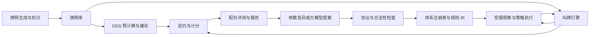

# 架构、对象与接口

## 1. 模块边界



模块内部允许简单实现，模块边界必须明确。不要为了外观提前拆成微服务。

## 2. 核心对象

| 对象 | 最少字段与约定 |
| --- | --- |
| `Card` / `Hand` | 牌张唯一；每手 13 张；一副牌 52 张不重复 |
| `Deal` | 按 N/E/S/W 明确保存四手牌；内容标识不传入策略 |
| `Board` | Deal、dealer、NS/EW vulnerability；局号仅用于调度和日志 |
| `Call` | Pass、X、XX，或 level=1..7、strain=C/D/H/S/NT |
| `AuctionState` | 发牌人、当前行动位置、完整历史、最近定约、加倍状态、连续 Pass 数、是否结束 |
| `Observation` | 自己手牌、座位、发牌人、局况、完整公开历史、公开体系说明、合法动作 |
| `Contract` | level、strain、declarer、doubling=1/2/4；四 Pass 为独立的 passed-out 状态 |
| `DDTable` | 显式 declarer×strain 轴；每个数值为该庄位可得墩数 0..13 |
| `SystemDefinition` | schema、不可变版本、特征定义、协议定义、决策规则、兜底、生成说明 |
| `DecisionTrace` | 命中规则、特征值、协议状态、选择原因；仅评测端保存，含私牌时不公开给其他位置 |
| `EvaluationResult` | 模式、数据集/对手/体系版本、逐牌分数、IMP、置信区间、失败状态、运行清单 |

花色和座位在内部可用枚举，但外部 JSON 必须用明确名称，禁止依赖 DDS 库自身的数组顺序。

## 3. 概念接口

以下是语义契约，编码时可用 dataclass、Protocol 或等价结构实现。

```python
legal_calls(auction: AuctionState) -> tuple[Call, ...]
apply_call(auction: AuctionState, call: Call) -> AuctionState
final_contract(auction: AuctionState) -> Contract | PassedOut

observe(board: Board, auction: AuctionState, seat: Seat,
        public_systems: PublicSystems) -> Observation
decide(system: SystemDefinition, observation: Observation) -> Decision
# Decision 初版为 call；后续可扩展为经过验证的动作概率分布。

validate_system(system: SystemDefinition) -> ValidationReport
render_system(system: SystemDefinition) -> str
simulate(board: Board, systems_by_side: SystemsBySide) -> AuctionResult

solve_dd(deal: Deal) -> DDTable
score_contract(contract: Contract, tricks: int,
               vulnerability: Vulnerability) -> int  # 庄家一方视角
score_ns(board: Board, auction_result: AuctionResult,
         dd_table: DDTable) -> int                  # 南北统一视角
signed_imp(point_difference: int) -> int

evaluate(spec: EvaluationSpec) -> EvaluationResult
propose(parent: SystemDefinition, context: MutationContext) -> Candidate
evolve(spec: EvolutionSpec) -> EvolutionRun
```

规则强度、逼叫等属于体系语义，不能混进通用合法叫牌引擎：违反逼叫约定与违反桥牌叫牌规则是两种不同问题。

## 4. 信息隔离

评测端知道四手牌，但策略执行器只能接收序列化后的 `Observation`。不要把整个 `Board` 传给策略，再靠开发者自觉不访问其他手牌。

策略不能获取：其余三手牌、DDTable、par、数据集行号、发牌种子、另一桌结果、历史牌例记忆或其他牌手的私有 trace。策略不允许文件、网络、时间、环境变量或共享可变内存访问。

初版解释受限 IR 即可，不需要把任意 Python 放入沙箱。离线进化程序可以分析训练牌的完整记录，但生成的运行时策略必须遵守观察边界。

搭档公共协议状态只能由公开历史和公开协议重建；私有推断只能留在各自策略内部。禁止通过调试信息、共享随机种子或私有状态共享传递手牌。

公开解释只说明事先约定的含义，不能泄露本次规则命中的实际私牌条件。事后研究报告可以显示完整牌例。

## 5. DDS 适配与缓存

- 以官方 DDS 为优先起点，记录库版本、构建标识、绑定版本和 API 契约。接入前核实当前接口，不能把不同版本的线程模型混用。
- DDS 给出墩数；通用计分器另行处理阶数、局况、加倍和视角。
- 初版按精确座位顺序的 Deal 内容缓存完整 20 项表；缓存键不需要局况或发牌人，因为墩数与二者无关。
- 若缓存 par，则额外记录局况、发牌人及所用算法。
- 初版不做花色/座位旋转压缩；以后加入时必须同时变换结果表的轴。
- 缺少真实 DDS 时显式报告 unavailable。测试替身记录 `oracle_kind=fixture`，不进入科学评测排名。
- 每个库错误都保留错误码和牌例。不能用零墩、平均墩数或随机数补齐。

## 6. 存储和不可变性

开始可使用 SQLite 保存索引和结果、JSON/JSONL 保存体系与对局，无需先引入大型数据库。批量数据格式按实际测量再升级。

体系内容哈希至少覆盖全部可执行语义、特征定义及依赖版本。展示名称和文件路径不承担身份作用。每个运行保存代码提交或源码快照标识、配置哈希、数据集哈希、DDS 版本和随机种子。

失败运行仍有 manifest，但其状态不能是成功。恢复运行时先核对 manifest，不能把不同配置结果接在一起。

## 7. 建议目录

```text
src/bridge_evolve/
  core/         # 牌、叫牌状态、合法动作、定约、计分、IMP
  systems/      # IR、特征、协议解释器、说明生成、体系注册表
  oracle/       # DDS 适配、缓存、真实与测试来源标记
  data/         # 发牌、导入导出、划分、manifest
  evaluation/   # 局部比较、两桌比赛、统计、报告
  evolution/    # 变异、候选验证、成绩筛选、归档
  cli.py
systems/        # 初始体系及不可变候选产物
experiments/    # 运行配置
tests/          # 核心、集成、科学有效性测试
docs/
prompts/
```

## 8. 目标 CLI

命令名可调整，但功能与失败语义应保留：

```text
bridge-evolve doctor
bridge-evolve system validate <system.json>
bridge-evolve system render <system.json> --output <system.md>
bridge-evolve system decide <system.json> --observation <observation.json> [--trace]
bridge-evolve system context <system.json> --observation <observation.json>
bridge-evolve auction run --system <system.json> --board <board.json> [--trace]
bridge-evolve auction run --mode general --ns <ns.json> --ew <ew.json> --board <board.json> [--prefix <calls.json>] [--trace]
bridge-evolve dataset generate --config <dataset.json>
bridge-evolve oracle precompute --dataset <manifest.json>
bridge-evolve auction replay <trace.json>
bridge-evolve evaluate --config <evaluation.json>
bridge-evolve evolve --config <evolution.json>
```

`doctor` 显示 Python、平台、DDS 是否可用及版本；不输出密钥。CLI 未实现时不要用空壳返回成功。

当前已实现doctor、体系校验/渲染/公开上下文/单手决策、局部1NT和通用四人整副叫牌，以及dataset generate/show、oracle precompute、evaluate、records和evolve。v1按 [原语言说明](07-executable-systems.md)，v2按 [通用协议](08-general-protocols-v2.md) 使用严格JSON。`PublicWorld`只接收双方事先公开的定义、发牌人、局况和叫品；公共求值器`PublicView`不含手牌。`Observation`可携带不可变的双方静态公开定义，但不携带其他私牌、动态trace或整副Board。逼叫约束由协议层检查，通用合法动作不改变。`auction run`仍是无成绩单桌叫牌；独立`evaluate`调度两桌并在策略结束后查询真实DDS计分，见 [真实评测](09-classic-evaluation.md)。

## 9. E003自主研究边界

`evolution/research.py`负责持续模型/工具会话；`research_tools.py`负责工作中的完整IR、牌例、断言、调试、讨论、探索比赛和冻结发布；`models.py`固定模型并管理共享请求/token额度。原可信`execution.py`继续负责正式新牌比赛，研究工具不能改写它。

工作区是数据能力边界，不是可执行任意Python或shell的主机目录。Agent能改整个v2体系，能运行真实解释器和DDS，但只能通过明确工具操作自己的IR/测试数据及已完成的批准记录；没有文件路径、网络、密钥或任意命令工具。公开转移中的私有特征限制仍由类型/作用域检查器执行。新增语言算子须另行开发并验证。

每次工具调用先记录身份，数据修改和返回结果一起持久化；重放同一调用不重复插入规则。模型响应、工作区、测试和发布物都有校验哈希。崩溃后恢复原会话和输入，未返回的模型请求仍占额度，不回滚成本。上下文交接只缩短下一次模型输入，不清除完整磁盘研究记录。

## 10. 待实现：研究单元与评价解耦

上述是已有原型；当前控制器仍先串行结束各谱系研究，再统一评价。E006还证明测试大失败能经继承/交接绕过导航的结果限长。按[近期计划](14-autoresearch-plan.md)，下一步不重写引擎，而是增加可信编排层：

```text
研究会话 -> 冻结完整候选 -> 持久评价意图 -> 有界评测队列 -> 结论/归档
                                                |
                         单独批准的新牌确认 <---+
```

队列身份包括候选/父本、引擎、参考、评分、阶段及共同输入。冻结比较集合后才生成新牌，后到候选另开批次；重复发布不算新候选，恢复不重复预留/计费。模型请求与配对/时间预算分别管理，但都保持硬上限。

计划中的evaluation-only不初始化模型，只处理冻结候选。单可信写入者负责预算、检查点与冠军指针，复用现有DDS池/缓存；不需要多个研究Agent共享可变JSON或各自复制全局预算。

启动、错误、consult、handoff和展示必须共用有界摘要与完整结果引用。完整原证据留盘，模型不再因一个断言失败接收整套展开定义。以上能力尚未实现，不能把这个流程图当成现有调度行为。
