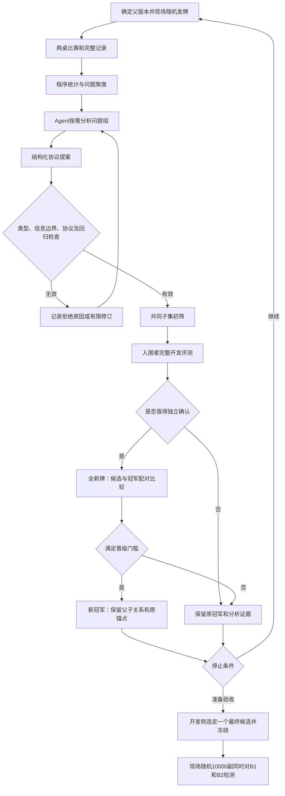

# Agent驱动的叫牌体系自进化：E002与E003

> 当前默认入口为[E003自主研究Agent](#17-e003自主研究agent)，使用GPT-6 Astra，允许全体系结构编辑、工具实验和空白原创。第1–16节保留E002底座、统计协议及旧版`source=agent`的历史能力与证据，其中一次性提案/白名单限制不再约束`source=research`。**不预留测试集，每轮现场随机发牌**；尚无10000副强目标通过结论。

> **2026-11-05状态更新：** E005已预算停止，E006完成1代后在第2代因上下文大小失败，均无新晋级。当前近期顺序以[Auto-Research计划](14-autoresearch-plan.md)为准：先修结果/交接和固定参考，再解耦评价，不直接增加研究规模。本页各日期条目保留历史状态；队列、evaluation-only、完整成本台账和1NT合同仍待实现。`.runtime/`与`results/`链接是本地证据位置，不随Git发布。

## 1. 目标与总体判断

目标：从当前CCBA和精确工程体系出发，自动提出、检验并积累协议改进，最终在**全新10000个基础牌族**上，分别显著优于这两个起始体系。

用户提出的“测试—统计—发现问题—Agent分析—修改—重测—更新基线”是合理的。它更接近**带反馈的黑箱策略搜索／进化式策略迭代**：奖励来自整套协议的比赛表现，不必先引入PPO、DQN、神经网络或逐叫价值函数。

需要修正四点：

1. 每轮重新随机发牌，不保留固定10000副。用于晋级/达标检测的新牌须在本轮候选确定后生成，不能看到结果再换几个补丁试同一轮。
2. 负IMP、宕约、DDS可成却未叫不一定是叫牌错误；先诊断，再检验假设。
3. 一个反例修好不等于策略更强；每个候选必须在共同的完整评测配置上重跑。
4. “有进步就更新基线”须经过新牌确认，而不是看到开发集均分略涨就覆盖旧版。

第一阶段仍只按成绩优化。复杂度、说明长度、是否像传统体系、人类参考匹配率均不加入适应度。人类参考帮助诊断和提案，不要求所有候选模仿人类。

## 2. 固定锚点与起始谱系

当前版本经实际IR载入核对：

| 标识 | 起点及固定对手 | 内容哈希 |
| --- | --- | --- |
| B1 | [CCBA工程v5.5.3](../systems/classics-v5.5.3-compact/ccba.json) | `aaf72a92d4c1c502e15cbc15b23b5aa935c4ea48b6f285be39b3a1de93418bcf` |
| B2 | [精确工程v5.5.3](../systems/classics-v5.5.3-compact/prec.json) | `e7b1195848a3eaa420e099d52ee832227a0ceebb5884c820e6c92680d493c4ff` |

- B1、B2是始终不变的目标锚点，不因某次晋级而移动。
- 以两者分别建立一条候选谱系，各自保留当前冠军`I_t`；不在一轮中随意拼接两套不兼容约定。
- 任何后代保存父哈希、完整新IR、同源自然语言说明和修改记录，不覆盖起始文件。
- 所有牌手获取该场实际候选的公开体系定义，不能表面宣告B1、内部却执行另一套私有协议。

历史对手和自对弈可作为后续稳健性诊断，但不能中途更改主对手池的权重后继续画同一条成绩曲线。这次目标是优于上述可执行工程版本，不是证明优于两份手册的一切人类实现。

## 3. 怎样定义“显著”和“非常明显”

### 3.1 每副的分数

候选`C`对每个固定对手`B_i`，在同一Board做两桌换位：

```text
Y_i(f) = signed_imp(桌1_NS分数 - 桌2_NS分数)
桌1：C_NS / B_i_EW；桌2：B_i_NS / C_EW
μ_i = 10000个基础牌族的Y_i均值
```

对B1、B2使用同一份10000副，保持手牌、发牌人和局况一致。总计20000个两桌配对、40000桌，但统计样本量仍为**10000个基础牌族**。两场比赛及相关变体都不能扩充独立样本量。

### 3.2 建议的验收门槛

以下是首次运行前要写入实验配置的**建议默认值**，不是已获得的成绩：

- 每次达标检测先确定**一个**候选，再现场生成10000副。当前实现默认每个实验最多一次达标检测；不在启动时生成或预留这10000副。
- 总名义错误水平`α_final=0.05`；两个对手各用`α=0.025`的一侧检验。
- 按基础牌族联合重采样两列`Y_1/Y_2`，20000次配对bootstrap，分别取2.5%分位数为下界`L_1/L_2`，即各自97.5%单侧下界，Bonferroni控制两个比较的名义总错误水平。
- `L_1>0`且`L_2>0`：可标为“分别统计显著优于起点”。
- 建议把“非常明显提升”设为`δ_target=0.20 IMP/副`，**只有两者均满足`L_i>0.20`才宣布完整目标达成**。
- 不得有未处理的执行、协议或计分失败；不能删除失败牌后检验。

因此，“均值涨了0.20”与“有证据表明至少涨了0.20”不同。未达到后者可以报告初步进步，但不能宣布达到“非常明显”的目标。0.20可在首次运行前调整，不能在看到检测结果后修改门槛。

bootstrap结论依赖抽样和方法假设，不是有限样本的绝对保证。10000副也不保证检测任意小提升：先用已完成的随机轮次估计收益方差、做功效规划；不能看到区间不够好后不断追加牌或换统计方法。

## 4. 每轮随机新牌，不预留数据池

没有预先准备的train/validation/test牌池。下面是评测用途，不是事先保留的不同数据集；每个阶段开始时由可信程序新抽一份牌。

| 轮次 | 研究规模建议值 | 生成时机 |
| --- | ---: | --- |
| 本代诊断 | 2000副 | 本代开始，用当前冠军对两个锚点评测并提供问题线索 |
| 候选有效性 | 128副 | 提案解析和类型校验后，检查执行、信息和协议 |
| 初筛 | 1000副 | 本代候选确定后；同轮全部候选及父版本使用相同新牌 |
| 完整复筛 | 5000副 | 入围后再生成，不沿用初筛子集 |
| 晋级确认 | 5000副/次 | 候选与父版本确定后新生成，双方共同对战相同锚点 |
| 达标检测 | 10000副/次 | 选定一个候选之后现场生成；没有预留集 |

所有完成轮次的牌例都可以用于之后的Agent诊断、反例和回归分析。独立性来自“下次质量评测抽新牌，且候选先确定”，不是来自永远隐藏某一批牌。已看过的数据不能重新标成新抽样证据。

采用无条件随机完整发牌和预定平衡的发牌人/局况。每轮随机种子自动生成并保存用于复现；种子不是必填。可显式设置主种子重放整次实验，但仍为不同轮次派生不同种子。额外的条件压力牌不能混入均匀随机成绩而不标明。

同一轮比较仍须用共同牌，不能让C、父版本、B1/B2各自抽不同牌后比较有噪声的均分。程序先保存轮次清单，之后才执行；失败牌不替换。暂停、重试或恢复仍使用该轮原清单，这属于完成同一次评测，不是发起新一轮。

首版提案Agent是本机网关上的**纯文本、无工具**调用：只收到可信程序准备的历史分析包，不能读文件、查询当前DDS缓存或修改评分代码。若以后改成有通用文件/命令工具的Agent，必须另做权限隔离，不能只在提示词里写“不读取”。

新牌会增加DDS初次求解成本；同轮候选/对手复用真实DDS缓存，仍保留配置中的新鲜交叉核验。文件manifest继续使用现有`validation`标记，但每个manifest代表现场生成的一个轮次，并不表示预留数据池。

## 5. 一代进化的闭环



设计目标为每代总计8个候选、最多2个入围者；首版实现先限制为每条谱系最多2个提案，即每代最多4个。每个质量评测阶段独立抽新牌，阶段内共享。当前有效性检查包含类型、同源说明、随机执行/公开私有区间/确定性；人工叫品停成错误定约等策略线索保留供分析，不伪装成执行崩溃。自动生成更全面的边界与对手干扰压力合同仍待增强。

任何阶段的旧结果只有在候选、对手、手牌、发牌人、局况、引擎和求解器身份均匹配时才可复用。初筛可早淘汰，但必须按预定阶段比较，不能把普通固定样本区间当作随时停止都有效的序贯检验。

## 6. 记录哪些统计才对设计有帮助

| 层次 | 需要的结果 | 作用 |
| --- | --- | --- |
| 整体 | 对B1/B2各自配对IMP、胜负平、样本量、区间、有效性状态 | 排名与目标进度 |
| 父子差异 | 同牌收益差、首次分歧叫品、定约/庄位变化、正负贡献牌 | 确认修改实际影响了什么 |
| 叫牌模块 | 开叫、支持、邀局、干扰、控制扣叫、问关键张等覆盖率和条件选择率 | 找高频或未覆盖分支 |
| 合作流程 | 邀请发送/接受/拒绝、人工问答后停叫、逼叫续叫、定将一致性 | 找搭档协议协调问题 |
| 桥牌结果 | 部分定约/成局/满贯分布，DDS成宕、漏局/漏贯线索，加倍/牺牲情况 | 产生假设，不单独作为奖励 |
| 信息正确性 | 公开承诺真假、上下界/关系单调性、私有信息隔离、未解决逼叫 | 有效性门禁 |
| 运行 | 分阶段耗时、DDS命中、模型请求/token、候选拒绝原因 | 调度、预算与排错，不进入适应度 |

条件统计必须保留分母，不把单独一个叫品或规则ID混成相同场景。跨版本分析需要稳定的模块/语义标识和完整公共前缀；改了含义的同名叫品不能直接视作相同条件。

优先分析**与父版本的配对收益差**，而不是把负IMP全部归罪于最后一叫。发生分歧前的决策、对手选择和后续协议都可能改变终局。

## 7. 问题筛选与Agent分析包

### 7.1 将“错误”与“改善机会”分开

1. **硬错误**：非法叫品、私牌泄漏、公开承诺不实、协议冲突、未解决逼叫、计分不一致。进入修复/阻塞流程，不能靠平均收益掩盖。
2. **高价值假设**：同类局面反复失分、邀请与接受不匹配、配合识别不一致、过早关闭叫牌空间。
3. **弱诊断线索**：DDS可成却未叫、单副宕约、与人类参考不同。可能是合理风险选择或当时信息不足。

DDS/par是牌后全知信息，不能把每副最佳定约变成叫牌标签。人类参考也是建议，不是额外的模仿损失。最终仍检验整套协议的配对IMP。

### 7.2 不把海量记录一次交给模型

程序先按“模块＋公共阶段/完整前缀＋配合/逼叫信息＋相关牌型/点力区间”聚类，再给Agent：

- 问题组ID、出现次数和覆盖分母、失分分布、证据强弱。
- 少量去重代表牌：严重失败、典型情况、边界及相邻正常/反例。
- 涉及的IR节点/共享特征引用、此前假设与修改结果。
- 按需读取单副或单叫的工具，使用[紧凑记录与Agent视图](11-compact-records.md)，而不是整批展开JSON。

“分析所有问题”定义为：所有**已识别问题组**进入台账，有已分析、已提出假设、待补证据、暂不修改或已验证的状态；不是声称穷尽全部桥牌错误。预算不足时明确保留未分析组，不偷偷丢弃，也不要求Agent为每个DDS线索强行改规则。

完整待办ID留在分析台账，模型输入限制为160KB。大批次只向模型提供待办总数和小型ID样本，必要时明确延后较旧反馈；不会为了满足上下文限制删除磁盘上的问题组。批准的提案输入另存并校验哈希，修订请求的错误另行留档。

频率、严重程度和可能收益可帮助排优先级，但不是精确的因果归因或适应度。对没有公开信息支持的“这副牌应直接叫贯”，Agent应该允许结论为“不构成可执行改进”。

## 8. Agent能修改什么

首轮集中在已有IR内的邀局、定量邀贯、支持及控制条件，逐步扩展。Agent输出受限结构化提案，而不是直接改整个仓库：

```text
父体系哈希 + 模块范围 + 可证伪假设 + 问题组/牌例引用
  + 按语义ID定位的IR修改
  + 发送规则、公开含义/状态转移、回答和退出的联动影响
  + 新增边界/反例测试 + 预期收益与风险
```

- 修改共享特征时列出全部使用点，不能全局替换某个数字却声称只改一条分支。
- 发送、理解、续叫作为一个原子协议变更；自然语言由候选IR生成，不能额外藏一套模型判断。
- 不允许更改DDS、桥牌计分、评测器、牌例选择、统计门槛、原锚点或对手权重。
- 不允许按牌例ID、种子、真实同伴手牌或DDS结果写运行期规则。
- 新算子/语言能力进入独立扩展请求，不能由优化Agent顺手修改可信引擎。
- 提案为数据解析，不把模型返回内容当作shell或任意Python执行。

可用一个Agent完成分析和提案，独立可信程序负责验证与评价；不必先搭多个Agent互相表决。保留确定性参数变异器/录制提案作为对照与断网测试来源，但不用等它先找到提升才接入Agent。

## 9. 校验门禁不能冻结住旧策略

固定不变的是合法性、信息隔离、协议可执行、公开保证真实、计分及复现规则；不是要求新候选在每副牌上继续出旧叫品。

- 通用门禁由可信程序掌握，Agent不能删除或放宽。
- 候选自己的语义合同应由新IR及可信检查机制解释/生成；合法改变点力范围或问答编码时，相关期望要随协议变化，不能用旧范围把新设计一概判错。
- Agent提交的示例测试只是补充证据，不能自证正确。
- 要覆盖改动相关分支、边界、相邻条件、对手干扰、回答和退出；覆盖不足标为待验证。
- 未编码或没检查到的承诺不得记作通过；记录检查覆盖与未支持项。
- 每次运行重新生成完整说明，校验发送与接收语义，执行确定性复跑和公共/私有信息检查。

候选自身有任何未解决的硬错误，整次候选评测不能进入排名。审计台仍可继续保存失败牌供排错，但“剩余有效牌均分”不能成为进化适应度。

硬错误与策略缺陷必须区分：非法叫牌、虚假公开保证、执行异常或DDS/计分故障使候选无效或比较阻塞；合法完成但人工短套答叫被停成定约等诊断提示仍按真实终局计分，并随牌例提供给Agent。否则把原体系每个叫牌弱点都判成“不能比赛”，反而无法通过进化修正这些弱点。原有审计器的`completed-with-findings`不是`failed`。

## 10. 筛选目标与新基线晋级

### 10.1 开发侧排名

固定两个对手各占一半：

```text
J(C) = 0.5 × mean(Y(C,B1)) + 0.5 × mean(Y(C,B2))
```

只对完成当前预定评测阶段且有效的候选计算；不同阶段的分数不混排。每个对手的单独成绩同时保留，不能只展示合计掩盖某一项失败。并列时保留原冠军或按稳定内容哈希处理，不使用复杂度破同分。

### 10.2 全新确认牌上的父子比较

对入围候选`C`和其谱系冠军`I_t`，同时在新确认块上对战相同B1/B2：

```text
D(f) = 0.5 × [Y(C,B1,f) - Y(I_t,B1,f)]
     + 0.5 × [Y(C,B2,f) - Y(I_t,B2,f)]
```

对`D(f)`按牌族重采样，不比较两条独立置信区间是否重叠，也不比较来自不同牌集的均值。

建议默认晋级条件：

1. 双方在同一5000副确认块上完整有效。
2. `mean(D) ≥ 0.05 IMP/副`。
3. `D`均值的单侧bootstrap下界大于0。整个实验、两条谱系**合计**最多10次确认尝试，单独分配`α_promotion=0.05`，每次`α=0.005`，仍用20000次重采样。
4. 对每个固定对手的**观测父子差值**均不低于`-0.05 IMP/副`，防止明显偏科。该项是预设成绩保护条件，不宣称它另有同样的置信保证。
5. 保存验证、差值、IR和说明后，原子更新该谱系冠军指针。

候选是自适应产生的，所以确认牌在候选冻结后才生成。尝试次数和错误预算写入持久状态；重启不重置，失败确认不在同一轮换几个补丁再试。确认结果可用于之后开发，下次确认另抽新牌。

“晋级”为开发阶段的新基线，不等于已经达到最终双基线目标。B1/B2从不被这个指针替换。

## 11. 现场随机10000副如何使用

1. 在现场生成的一轮共同牌上比较已进化的谱系冠军，选定一个候选；原始未改版本不浪费10000副检测。优先比较较弱对手上的均值，再看等权均值。
2. 冻结完整IR/说明、引擎、两个原对手、数据分布、样本量、统计方法及门槛。
3. 此时才随机生成10000副，可信评测端完成与两个对手的比较，全部配对完整后才计算结果。
4. 输出对B1、B2各自的均值、同时解释的下界、有效性状态，以及`target_met / statistically_better_only / not_established / invalid / blocked`。
5. 达到第3节强门槛才宣布目标达成；否则如实保留结果。

结果完成后允许用于下一轮分析，不必永久隐藏或预留；之后新的质量结论使用新的随机牌，不能重用旧结果冒充新证据。

当前每个实验最多一次达标检测。若研究要重复多次，必须在**第一次检测前**确定跨实验/尝试的总错误预算，再对“尝试×两个对手”校正；不能每次失败后新建实验换10000副、重新给自己0.05，直到碰到一次显著结果。是否现场随机与是否需要处理重复检验，是两个独立问题。

## 12. 故障归因、停止与恢复

| 情况 | 处理 |
| --- | --- |
| 提案解析/类型/协议检查失败 | 记录拒绝原因，最多有限修订；不生成虚构成绩 |
| 候选自身非法/泄漏/承诺不实 | 候选无效，保留反例，不删除失败牌 |
| 固定对手在合法竞争下崩溃 | 标为对手/基线缺陷并阻塞，不当作候选获胜；不得自动修改原对手后继续同一实验 |
| DDS、进程或存储故障 | 相同输入有限重试；仍失败则暂停/失败，不补零分或换牌 |
| 改动需新算子 | 保存扩展请求，转独立引擎开发流程 |
| 没有可信提升 | 保留冠军，记录未改进，而不是强行推进版本 |

如果确实要修固定对手，须保留原失败记录，发布新的实验版本并明确目标锚点发生变化，不能冒称仍在战胜原配置。

首版研究配置上限默认20代、每代最多4个候选、10次晋级确认、连续3代无晋级则停止，另设运行时间、模型请求数和总配对数预算；单次输出也有固定token上限。预算只用于调度/停止，不作为体系成绩惩罚。

候选因资源预算尚未完成评测时标为未评估/未完成，不据此宣称它牌力较差或因复杂而扣分；只允许完整可比成绩参与排名。

断点记录到已完成的“候选×对手×牌族”单元；恢复先核对所有身份与配置，不能混接不同IR或引擎结果。最终测试不暴露逐步区间，不按中途普通区间随意早停。停止不等于目标一定达成。

## 13. 实现状态与待增强能力

| 阶段 | 首版状态 |
| --- | --- |
| A：可信实验骨架 | 已实现：配置/IR/说明/引擎/DDS冻结，按需新牌、同轮同牌、严格两桌评测、压缩缓存与日志 |
| B：分析与台账 | 已实现受限模块聚类、上下文/对手区分、代表牌、覆盖与延后计数、小型模型分析包；边界自动生成待增强 |
| C：提案与门禁 | 已实现纯文本Agent、显式数字/录制对照、语义ID白名单、类型/作用域/说明和随机严格检查；并非穷尽协议证明 |
| D：进化控制器 | 已实现多代双谱系、独立新牌筛选/确认、共享尝试预算、冠军指针、锁、取消、恢复及无提升保留 |
| E：检测与展示 | 已实现选定候选后新抽10000副、双对手单侧统计、CLI/首页/代际和牌例入口；实际强目标尚未验证 |

复用现有模块，而不是新造计分或DDS：

- [配对评价与计分](../src/bridge_evolve/evaluation/experiment.py)、[DDS缓存](../src/bridge_evolve/evaluation/cache.py)、[统计](../src/bridge_evolve/evaluation/statistics.py)。
- [可执行IR与观察](../src/bridge_evolve/systems/runtime.py)、[公开协议](../src/bridge_evolve/systems/v2_runtime.py)及同源说明。
- [紧凑日志与Agent视图](11-compact-records.md)、[审计与并行牌例执行](../tools/board_viewer.py)。

实现入口为[进化包](../src/bridge_evolve/evolution/)、[可运行配置](../experiments/e002-pilot.json)和[测试](../tests/test_evolution.py)。它与原来的自动编程开发控制器分开；提案模型不能修改引擎或评测器。

普通审计单批仍上限1000副；进化评测端独立支持单轮10000副，统一manifest/样本向量/牌族唯一性。界面按每次最多1000副导入诊断牌例，不把分片当作多个独立检测。

当前补丁只可修改提供的发送规则`when/action`和公开转移`when/set`，不能新增/删除规则、状态、算子或修改优先级。Agent的`test_plan`是待验证的文字计划，不是已经运行的断言；改动相关的完整边界/干扰合同、结构变异、历史对手联赛仍属于后续工作。

计算量按“基础牌族×对手×两桌×候选”估算，不把表数当作样本量。Agent只读小型分析包，冻结IR每进程加载一次；模型预算、求解缓存和实际分阶段耗时单独报告。

## 14. 第一个可交付里程碑

先运行**3代小闭环试验**，不自动发起10000副检测：

- 两个起始谱系；每代最多4个候选，允许有理由地不提案。
- 128副有效性烟测、共同200副初筛、最多1个入围者跑1000副开发评测。
- 晋级确认用全新2000副，尝试预算和门槛仍预先固定。
- 先开放邀局/定量邀贯等已有算子的局部条件，同时修改接收方和公开协议；不要求先完善所有传统体系分支。
- 全部提案、拒绝、复测、未提升和晋级都能追溯、暂停和恢复。
- 无须人工逐个修改/提交候选；没有提升也应正常结束并保留原冠军。

这一步验收的是自动闭环能否可信工作，不保证三代出现收益。通过后再扩大到第4/5/10节的研究配置，目标仍是第3节的10000副双锚点验收。

## 15. 运行方式与配置

在项目目录运行，要求真实DDS及本机已认证模型网关。不会把网关密钥写入实验文件：

```bash
# 三代工程烟测：诊断/有效性/初筛/复筛/确认=16/8/16/32/64副
.venv/bin/bridge-evolve evolve run --config experiments/e002-pilot.json --profile smoke

# 三代pilot：128/128/200/1000/2000副
.venv/bin/bridge-evolve evolve run --config experiments/e002-pilot.json

# 先冻结配置但不发牌；返回实验路径
.venv/bin/bridge-evolve evolve init --config experiments/e002-pilot.json

# 以下RUN替换为返回的 .runtime/evolution/evo-... 路径
.venv/bin/bridge-evolve evolve status --run RUN
.venv/bin/bridge-evolve evolve cancel --run RUN
.venv/bin/bridge-evolve evolve resume --run RUN --clear-cancel

# 明确选取已进化冠军、再随机10000副检测；无新冠军不会浪费检测预算
.venv/bin/bridge-evolve evolve verify --run RUN
```

首页“叫牌体系自进化”可选择两个起始体系、Agent或数字对照、smoke/pilot规模及代数，查看/取消/恢复任务；详情可查看每代拒绝和成绩，打开各轮对应的审计牌例。整理和回收站操作与审计相同。

配置见[e002-pilot.json](../experiments/e002-pilot.json)。`baselines/replay`中的相对路径按**项目目录**解析，不按配置文件目录。可选`random_seed`不填自动生成随机种子；`boards`可逐阶段覆盖，`workers`为1–4。`source=numbers`只用于明确的工程对照，Agent失败不会悄悄退回数字变异。

`smoke`与`pilot`默认不自动运行10000副。示例配置也显式设置了`automatic_goal_check:false`和`generations:3`，所以单加`--profile research`不会覆盖这两个显式值。正式扩大研究时另建配置，确定代数、自动检测开关和足够预算；自动检测还要求新牌选择成绩达到预设点估计门槛。`verify`可显式跳过该准备度门槛，但不跳过完整评测、次数预算或双比较统计。10000副检测总是至少20000次重采样。

实验目录含冻结配置/IR/说明、`state.json`、`analysis/`、`proposals/`、按需生成的`rounds/`、压缩SQLite配对缓存和`report.md`。默认状态输出是小型摘要，`status --full`才展开完整状态；大提案单独存储而不反复塞回状态。运行期间修改可信源码、配置或冻结输入会阻止混用成绩，须新建实验。完成闭环、找到晋级版本和达到强目标分别报告。

## 16. 首次真实闭环验证

2026-11-03，以当前两个原始v5.5.3体系运行Agent来源的三代`smoke`，不是数字变异替身：

- 6次已认证模型请求、6个提案，完成3代；1200个两桌配对/2400桌，来自12轮共216个互不重复的基础牌族。
- 3个候选复测未见提升，1个公开HCP区间冲突被判无效，1个重复提案，另1个未进入完整复筛；**0次晋级，保留两个原冠军**。
- 所有轮次种子不同，同轮每个候选/对手的牌、发牌人和局况逐条一致；核对全部1200条日志、IR/说明/日志哈希、真实DDS来源和持久预算。
- 6个实际分析包约100–119KB；未生成、预留或使用任何10000副检测，不能据此宣称达到强目标。
- 控制器计时约748秒。烟测规模很小，主要证明闭环真实可运行，不是牌力提升或大规模效率结论。

机器证据见[实跑与完整性核对](../results/evolution-validation/live-agent-validation.json)，界面验证见[首页/详情/牌例导入](../results/evolution-validation/ui-validation.json)及[取消/原输入恢复](../results/evolution-validation/ui-controls-validation.json)。473项完整Python回归、最终20项进化专项和22项前端测试通过；后续上下文保护未改变实跑中6次模型输入的任何字节。

[上下文压力验证](../results/evolution-validation/context-volume-validation.json)用模拟的一万个问题组检查完整台账与160KB模型限制，**不是一万副牌的强度评测**。总验证摘要见[validation.json](../results/evolution-validation/validation.json)。

试跑还复现并修正了执行器把策略诊断误判成硬失败的问题：[同一副牌重放](../results/evolution-validation/terminal-finding-reproduction.json)在原审计器中合法完成、硬错误为零，真实收益为11IMP；提示仍保留，未修改原体系，也未删除问题牌。真实候选执行错误仍判无效，真实对手崩溃仍阻塞，不能拿到虚构胜利。

## 17. E003自主研究Agent

### 17.1 从提案器改为研究者

当前`source=research`不是一次性返回受限JSON，而是持久的Responses工具循环：

```text
共同随机牌诊断
→ 自主研究会话：阅读 ↔ 设计 ↔ 发牌 ↔ 编写断言 ↔ 调试/复测 ↔ 讨论
→ 发布完整冻结候选
→ 可信程序在新共同牌上验证、复筛和确认
→ 晋级或保留研究分支，继续下一代
```

完整v2定义可整体替换，也可用JSON pointer逐步增删：features、rules及优先级、announcements、protocol参数/状态/转移、回答、fallback均可变。没有8处编辑限制或规则ID白名单。中间版本允许类型或协议暂时不完整，实际错误返回同一研究会话；发布必须重新编译、生成同源说明，实际执行全部作者断言，并至少有一个`changed_from_parent=true`的行为变化见证。改名字或只换说明不算新设计。

`origins=["existing","blank"]`默认建立A/B/Z三条谱系。A/B来自原CCBA/精确，Z是只有显式Pass兜底的合法空白骨架；固定对手仍是原B1/B2。空白是指不继承人类约定，不是声称模型没有桥牌知识。未晋级工作版本及其案例、断言、研究记录在下一代可继续，不要求每次中间修改立即胜过冠军。

研究开始时提供少量诊断只是线索，不再是唯一可见规则。可以分页读取全部体系、语法和批准的完整历史记录。上下文过长时可主动`handoff`或自动做上下文检查点；完整磁盘记录不删除。

### 17.2 工具与权限

| 工具 | 实际能力 |
| --- | --- |
| `read_system` / `edit_system` | 任意体系节点读取；整套IR替换和原子add/replace/remove/test |
| `read_reference` / `read_workspace` / `read_evidence` | 实际语言文档/算子、自己案例/测试/工具历史、已完成轮次和逐叫证据 |
| `generate_cases` / `add_cases` | 复用已有完整合法发牌器，支持HCP/套长条件、组合手牌谓词及明确回归牌 |
| `inspect_case` | 实际单桌/逐叫调试；可选真实DDS两桌严格检查 |
| `write_tests` / `run_tests` | 编写并真正执行断言，不把文字test_plan当作已测试 |
| `validate_system` | 完整类型/作用域/引用检查与同源说明生成 |
| `trial` | 当前体系与父版本对两个锚点的真实DDS共同新牌探索，返回实际错误和行为变化 |
| `consult` | 另一次同模型独立质疑；引用选定IR及实际测试/探索结果，共享模型预算，不冒称独立验收 |
| `research_note` / `handoff` | 可读研究摘要及上下文交接，不要求记录内部思维链 |
| `publish_candidate` / `finish_research` | 冻结完整体系、说明和实际测试；明确完成或尚无可发布成果 |

研究者可以看授权的历史四手牌和DDS，运行期牌手仍只看自己的牌和公开信息。工具没有任意路径读写、shell、Python执行、网络或密钥访问；它们只操作自己的体系/测试数据和批准的完成结果。这比给模型主机shell更小、更可验证，但不限制其能改哪些叫牌协议。需要新算子时另走可信引擎扩展，不能把任意代码塞入策略。

条件牌和指定前缀是诊断，不冒充均匀主分布或策略自然到达的历史。生成不足时明确报错，不放宽条件。`trial`属于自适应开发证据；只有完整冻结后独立新抽的外层比较才能用于晋级。

可执行测试形状示例：

```json
{
  "name": "new-response-path",
  "case_id": "<生成或保存牌例后返回的ID>",
  "mode": "auction",
  "side": "NS",
  "prefix": [],
  "assertions": [{"path": "/contract/strain", "op": "eq", "value": "S"}],
  "changed_from_parent": true
}
```

断言支持eq/ne/contains/ge/le，也可用`mode=decision`检查下一叫的`/call`。测试目标由新协议决定，不强制保留旧叫品。作者测试和随机门禁都不是所有手牌、竞争及边界的穷尽证明。

### 17.3 模型和预算

新实验默认`model=gpt-6-astra`、`reasoning_effort=high`。已认证网关报告该精确模型ID支持Responses和工具调用；启动参数、实际返回的模型和用量入账。模型不存在、请求失败或网关返回不同模型均明确报错，不降级到旧模型。独立讨论使用同一固定模型，不隐藏调用便宜模型。

| 设置 | 默认自主研究配置 | 含义 |
| --- | ---: | --- |
| `max_agent_requests` | 576 | 全实验请求总量，包含研究、讨论及失败/未知结果的预留请求 |
| `max_agent_tokens` | 12000000 | 全实验输入/输出token及尚未结算的保守预留总额度 |
| `max_output_tokens` | 32768 | 每次请求输出上限，包含服务报告的输出token |
| `max_research_turns` | pilot 48，smoke 16 | 每代每谱系研究轮数；讨论另消耗全局请求 |
| `max_tool_calls` | 256 | 每次研究的不同工具调用上限；恢复同一调用不重复执行 |
| `max_releases` | 4 | 每次研究的完整候选发布上限，不限制编辑次数 |
| `max_lab_boards` | 256 | 每次研究生成/保存/试验所用的诊断牌预算 |
| `research_seconds` | 1800 | 每次研究活动时间，在安全边界检查 |
| `max_pairs` | 200000 | 全实验实际提交的两桌配对预算，含研究DDS及外层比较 |
| `max_seconds` | 21600 | 全实验累计活动时间，暂停/恢复不清零 |

请求发出前持久化占用请求数，并按序列化输入UTF-8字节、最大输出及4096的包装余量保守预留token。收到可靠`input_tokens/output_tokens`后用实际数量结算；失败、断连或未报告用量时保留原预留，不能当免费请求。预留不足不发起下一次请求，暂停恢复不重置。token是用量，不是按缓存折扣或模型倍率计算的金额；没有可靠实时价格/账单，**不显示虚构美元费用**。

配置和模型在实验初始化时冻结，没有就地更换模型或追加预算的命令。需要新配置时创建新实验，不能把旧成绩重标成Astra结果。旧E002运行仍保留自己的模型及原预算；示例旧提案配置的新运行模型已改为Astra。

研究用完轮数但尚未发布时，不必重新读文档、从空白丢掉进度。`--from-research <旧实验ID或项目内路径>`或首页“承接工作区，创建新实验”会复制兼容谱系的体系、回归牌、断言、研究记录及历史开发试验摘要，并记录源工作区/模型/引擎哈希。两个原对手及谱系父版本必须匹配；不复制正式成绩、晋级或测试牌，不修改旧预算或清除旧用量。新实验的模型和额度另行冻结，界面标明承接来源；发布前仍实际重跑断言，正式比赛仍现场抽新牌。这是明确的新实验，不是悄悄给原实验重置额度。

此入口主要承接未发布的研究草稿，不会继承源实验冠军或其晋级结论；已晋级谱系的连续优化应使用原实验的后续代数。跨实验直接继承已发布冠军的完整warm-start管理仍待增强。预算也是单实验资源上限，不是跨实验账户总费用封顶。

这是有限资源约束，不是对规则复杂度、说明长度或创新的成绩惩罚。16MiB工作IR、分页读取及上下文长度也是工程资源边界；不足必须明示，不偷偷缩减协议。

`e003-smoke.json`是专用的一代空白研究验证，显式覆盖为48轮、64次请求、800万token；不等同于只传`profile=smoke`时的默认16轮。每次研究的时间在工具/模型安全边界检查，不强杀正在执行的DDS原生调用。

### 17.4 发布、筛选和持续研究

发布保存完整IR、完整说明、精确测试定义/回归牌、实际测试结果和假设。之后继续编辑不会覆盖已发布版本。所有候选和未晋级分支归档，工具调用结果与数据修改一起持久化；重启后同一调用ID不会再次插入规则。

E003不再因初筛均值平分而只按哈希选一个复筛者：通过有效性检查的发布物均可进入同轮完整复筛。旧候选重复出现可以补评测，不把重复当成再次浪费提案。复筛未改变任何叫牌时标`insufficient_coverage`，保留研究而不冒称设计无效。

有实际行为变化、复筛均值非负的方案可申请新的独立确认，不再用小样本的`0.05`点估计挡住确认入口。真正晋级仍要求确认均值至少`0.05 IMP/副`、校正单侧下界大于0、每个对手的观测回退不超过`0.05`。同谱系替代方案可依次确认，合计共享原来的10次尝试及错误预算；每代每谱系至多晋级一个。

研究模式默认不因连续三代没晋级自动停止（`plateau_limit=0`）；仍受代数和全部资源预算限制。研究轮数耗尽会保存为`needs_more_research`，不假装发布或取得收益。谱系中途版本可以退步，正式成绩只属于冻结且完整有效的候选。

历史/适应型对手联赛、自动生成全面语义边界合同、新语言算子和更广的结构搜索仍可继续增强，不因开放编辑就宣称已经穷尽体系空间。

### 17.5 运行、查看与恢复

```bash
.venv/bin/bridge-evolve evolve models
.venv/bin/bridge-evolve evolve run --config experiments/e003-smoke.json
.venv/bin/bridge-evolve evolve run --config experiments/e003-research.json
# 承接旧实验中尚未发布的研究；不复制成绩，旧用量仍保留
.venv/bin/bridge-evolve evolve run --config experiments/e003-smoke.json --from-research OLD_RUN_ID
# 精确覆盖模型；不可用时失败，不回退
.venv/bin/bridge-evolve evolve init --config experiments/e003-research.json --model gpt-6-astra
.venv/bin/bridge-evolve evolve status --run RUN
.venv/bin/bridge-evolve evolve cancel --run RUN
.venv/bin/bridge-evolve evolve resume --run RUN --clear-cancel
```

首页可选模型、推理强度、现有/空白起点、任务及预算。实验详情展示已用/上限及实际token；“查看研究、调试与讨论”按需读取实际prompt、研究记录、讨论、模型消息、工具完整输入/输出和实际测试。旧版提案也有“模型回答”入口，不再只有一句假设。

API：

```text
GET /api/evolution-models
GET /api/evolutions/<id>/research/<gNNN-A|B|Z>?offset=0&limit=50
GET /api/evolutions/<id>/research/<session>?tool_call=<调用ID>
GET /api/evolutions/<id>/proposals/<gNNN-A|B|Z>
GET /api/evolutions/<id>/systems/<hash>.json
GET /api/evolutions/<id>/systems/<hash>.md
```

日志默认分页，完整模型响应和工具数据保留在`research/<session>/`，由原实验哈希校验，不在首页反复展开。原系统、审计回收站及历史成绩不覆盖。

## 18. E003真实Astra研究验证

以`gpt-6-astra/high`从空白骨架实际运行，再通过显式工作区承接继续研究。不是录制提案、数字变异或测试替身：

- 两段研究共91轮主会话／91次工具调用、3次独立讨论、3次真实DDS探索，合计94次模型请求，输入3358007、输出70578 token，共3428585 token。
- 首段用完48轮后保留草稿：58条规则、22个状态、17项已通过测试，没有伪称已经发布。
- 续接后由Agent实际复现并修复`nt_place.game`在高阶历史下非法重复3NT的问题，扩展到**40项执行测试全部通过**，其中3项验证无指定前缀的自然多轮行为确实区别于空白父本。
- 实际发布「Z·分区自然研究制 v1」：**58条规则、23个派生特征、22个协议状态**及同源完整说明。包含自然／无将／强2C开叫、应叫、邀请、转移及Stayman后续；没有主动争叫和满贯，干扰及未支持续叫使用明确的保守Pass出口。
- 在新的64副共同牌确认上，相对空白父本等权提升`+3.1875 IMP/副`，工程smoke bootstrap下界`+1.1953125`，通过该谱系晋级。**不是战胜原CCBA/精确**：同批观测均值分别为`-1.109375`、`-0.140625 IMP/副`。没有启动10000副检测。
- 逐条验证848条真实配对日志、232个跨轮不重复牌族、同轮共同手牌/发牌人/局况、冻结IR/说明/日志/案例哈希、DDS来源及每笔模型token账本。原两个锚点哈希不变。

完整回归497项Python通过；后续工作区承接等最终改动另跑35项研究/CLI专项，22项前端测试及真实浏览器模型/预算/日志/移动端验证通过。完整回归和最终实跑的引擎哈希分别记录，不混接为同一快照。

本次实现验证另保留17次工作区持久化故障复现请求和2次模型工具接口探针，共计113次真实Astra请求、3650969 token；不删除失败账本，不编造美元金额。持久化故障已通过不可变工具结果快照修复，并有精确回归。

证据：[总验证](../results/astra-research-validation/validation.json)、[逐轮与模型账本核对](../results/astra-research-validation/live-research-validation.json)、[晋级重算](../results/astra-research-validation/promotion-validation.json)、[界面](../results/astra-research-validation/ui-validation.json)及[续接操作](../results/astra-research-validation/ui-continuation-validation.json)。这验证了研究能力和可信执行链，不是完整体系空间、实战最优或万副双锚点目标的达成证明。

## 19. E004：持续迭代与实时看板

用户要求在后台继续多代研究，并从显示器追踪实际迭代、结果及当前体系。当前入口为[e004-live-iteration.json](../experiments/e004-live-iteration.json)：最多3代，固定GPT-6 Astra/high，沿用6小时、576次请求、1200万token及20万配对上限，不自动触发10000副。

### 冠军续跑，而不是重复从空白开始

`champion_seed_run`或`evolve init/run --from-champion OLD_RUN`继承来源实验各谱系的**当前冻结冠军**。源模型/引擎/文件哈希、回归案例和测试定义一起保存；旧成绩、数据轮次、晋级结论和消耗额度不转成新实验成绩或新额度。

来源实验中的谱系顺序保留，已发布原创Z体系可优先继续；未出现在来源的谱系按配置从原起点建立。既有行为变化见证相对新父本不再算新改进，因此转为普通回归；新的发布仍必须测试到真正区别于新父本的行为。某代晋级后，下一代使用新冠军和对应发布的案例，不会被初始化seed覆盖回旧体系。

`research_seed_run`仍表示承接未发布工作，两种入口不能同时指定。冻结配置、引擎和输入仍不能在同一实验内悄悄变更。

### 持久进度与重要迭代

模型请求在发送前保存开始时间和身份，工具调用保存开始/完成时间；测试、探索、讨论、发布、候选无效及晋级形成带稳定ID和时间戳的里程碑。重放同一工具调用不重复记录里程碑。

当前工作区提供轻量摘要：体系名/哈希、规则与状态数、案例数、最新假设、上次实际测试及探索。若测试后的IR已修改，会显示“待重新测试”，不会把旧测试绿灯贴到新草稿。当前冠军始终来自单独的冻结指针。

显示器约每2秒轮询持久状态；断线重试、页签/比较轮次保留、历史结果和当前体系阅读方式见[实时追踪说明](10-audit-workspace.md#体系进化实时追踪)。不是逐token直播，也不把内部思维链当作研究日志；展示的是可读假设、工具实验和可验证结果。

### 本次启动暴露的原对手问题

首轮128副诊断完整执行768个配对，在第86副复现了两项原始对手的公开套长承诺错误：

- CCBA的`opener_rebid.second_suit_C.r1134`路径公开草花至少5张，实际为4张。
- 精确的`strong_positive.longest_H.r1210`路径公开红桃至少7张，实际为5张。

原始实验`evo-fc022c1dfb5e4b60bd8e4f8689c26452`和失败牌保留，0次模型请求；没有修改两个原始锚点，也没有删掉这副牌或给它补零分。此前全局中止会导致研究尚未开始就停掉，因此改为区分：

1. **固定对手的协议/叫牌错误**：本轮比较仍为blocked，失败向量保留null，不进入排名。自主研究可以继续，但已知对手缺陷未解决前不确认正式晋级或10000副达标；新实验显式继承这些阻塞证据，不通过重新抽牌洗掉问题。
2. **候选自身错误**：候选无效，反馈给研究者继续修复，不伪装成完整有效。
3. **DDS/存储/未知归因等基础设施问题**：仍阻塞/失败，不当作普通策略问题放过。

这不意味着放宽了真实性检查，也不意味着已解决原对手缺陷。后续若需要修订锚点，必须新建明确版本并解释与原目标的关系，不能偷偷覆盖旧体系。

后台运行`evo-bd66215f9e14486498a13ebdc2f13ba0`从已发布原创v1继续，保留A/B重构谱系和上述证据；页面可通过`/?evolution=evo-bd66215f9e14486498a13ebdc2f13ba0`追踪。具体实时状态以持久记录为准，不把本节写入时的运行状态当作永久状态。

## 20. 修复参考后的显式续跑与网关重试

上述两处公开编码错误已在[v5.5.4](09-classic-evaluation.md#23-v554自然再叫与满贯探索的公开编码消歧2026-11-04)修正。原128副公开保证重放通过，旧参考保持不变。

E004随后实际因模型网关HTTP 503停止，留下82次请求、5371293个已结算/保守预留token及Z/A研究工作；不是把停止误写成正在运行。

新配置[e005-corrected-reference-continuation.json](../experiments/e005-corrected-reference-continuation.json)使用`research_seed_run`承接草稿，并以**非空`benchmark_revision_reason`**明确声明新参考。未声明时仍拒绝跨参考版本拼接。新状态记录原/新参考完整哈希、原因、来源及旧阻塞证据；旧问题是历史证据，不会挂到已经修复的新参考上当作同一错误仍未解决，也不删除来源记录。

承接时保留Z的83条工作规则、36副案例和48项测试，以及A的2827条工作规则和13副案例。Z保留原已发布父本，不退回全Pass；参考版本改变的A使用新父本，旧草稿保留并提示研究者对照修复，旧行为见证转成回归，需要新的实际变化见证。所有旧试验只作历史开发线索，正式成绩重新发牌。

本次按E004**剩余额度**设置新上限：494次请求、6628707 token、198973个配对及19917秒；原82次请求及那次未报告用量的503预留仍保留，没有通过新建实验抹掉消耗。新实验`evo-4490f1d93de14d4f9f42fd2585872191`的进度链接为`/?evolution=evo-4490f1d93de14d4f9f42fd2585872191`。

模型推理请求遇到HTTP 429/502/503/504最多额外重试两次，默认退避5秒、10秒；仍使用冻结的同一模型。每次尝试单独占用请求/token额度，未知用量不退回，受累计时间和取消检查约束。非暂时性HTTP错误、协议错误或模型替换不重试；达到次数或预算后仍明确失败/停止，不无限重试或降级模型。界面显示重试步骤和里程碑。

135项体系/公开信息回归、63项进化/迁移/模型预算与重试回归、28项前端测试通过。旧参考下的强度目标没有因此被宣布达成，新的参考版本及其成绩在看板单独标明。

## 21. 按分支组织研究上下文

[统一体系导航](13-system-navigation.md)已接入研究工具、CLI与展示入口。研究prompt不再要求先检查完整体系；默认通过`navigate_system`按阶段、叫品或语义ID定位，再读取所需依赖、公共接口和案例。批量定义、节点内分段、反向引用与语义diff用于替代大数组翻页和人工追踪`shared.*`哈希。

启动包只提供本会话的库存与诊断链接，完整证据仍可按JSON Pointer读取。跨分支重构的权限、全体系门禁、同源完整规范及成绩唯一适应度保持不变。本次没有重启E005、追加预算或声称已经实现并发coordinator。

## 22. E006：使用新导航继续研究

[E006配置](../experiments/e006-context-navigation-continuation.json)从已因本地token预算停止的E005显式继承研究工作，在当前引擎身份下创建新实验，仍采用同一v5.5.4固定参考。Z保留83条规则、46副案例、72项测试；A保留2827条规则、13副案例和未发布草稿，B从精确参考开始。旧发布、成绩、模型消耗及其未知用量预留仍保留在原实验，不搬成新成绩。

本轮新增的本地模型token上限为10000000，相比E005的6628707约提高51%；仍为`gpt-6-astra`、high推理，494次请求、198973个配对和19917秒的上限不扩大。新上限是本次独立授权的增量工作额度，不是旧预算余额或账号AI Credits，旧实验消耗不会被清零抵扣。

研究任务优先要求重新验证并及时发布成熟Z快照，A用语义diff定位公开编码迁移，B按诊断定位可完成的完整协议修改。仍为3代pilot、2个评测worker，并非并发专题研究；每个新评测阶段随机发共同新牌，重试重用已冻结输入，不预留10000副且不自动启动最终目标验收。

本次实验编号为`evo-31193a7f8b8e45b5bb5a7b106168ca58`，[实时追踪](http://127.0.0.1:8765/?evolution=evo-31193a7f8b8e45b5bb5a7b106168ca58)。运行状态与实际成绩以该实验的持久检查点为准。

启动验证已确认实际Astra响应及`navigate_system`成功调用。首轮128副新牌的768个配对尝试完成，但第101副暴露CCBA v5.5.4的显式未实现出口`No declared classic-policy completion`，保留4条关联失败，未删牌、补Pass或伪造成绩。研究按现有规则继续，固定参考缺口未另行修复前不作正式排名或晋级结论，也不在运行中改写参考。

## 23. E006停止结果与后续调整（2026-11-05）

E006于2026-11-04 11:00 UTC停止，约54分钟；178次Astra请求、9,704,028个统计token，完成1代，第2代停在B初始化，0次晋级、未执行10000副。不是目前仍在后台运行，也不是因模型额度已经严格用尽。

- Z两次重新发布同一`7a68e806…e67f5`继承快照，72项执行回归通过、8项相对父本的行为见证；没有新增两套设计。
- A两代96回合、75次导航，做3次编辑操作，仍无实际回归与发布。
- B新增强梅花低花正应后的2NT等待草稿，4项测试通过2项、失败2项，无通过的行为变化见证，未发布。
- 第一代候选有效性检查还发现CCBA在第11副承诺红桃至少4张、实际3张；固定参考问题保留并阻塞正式排名。
- 两条结构断言失败把完整决策展开到异常字符串，各约16.5MB；`last_tests`通过继承和handoff重新进入提示，超过1.5MB上限。导航已变小并不代表其他结果边界都安全。

因此近期不再仅增加预算或优化prompt。按[新的验收计划](14-autoresearch-plan.md)修反馈管道和参考，增加持久队列、evaluation-only及去重/资源预留，先让冻结成果获得完整评价，再做有合同的1NT Local vs Global多次Pilot。开发吞吐和真实成本用于工程诊断，不改变成绩唯一适应度。

Git已保存[Z发布索引](../systems/research-z/index.json)中的三个冻结协议、同源说明及两份发布回归输入；原始日志、未完成草稿和账户凭据仍在本地。归档不是重新执行72项测试，也不是把历史探索分数搬成新评价。跨引擎或参考修订后的评价必须另行登记来源。
